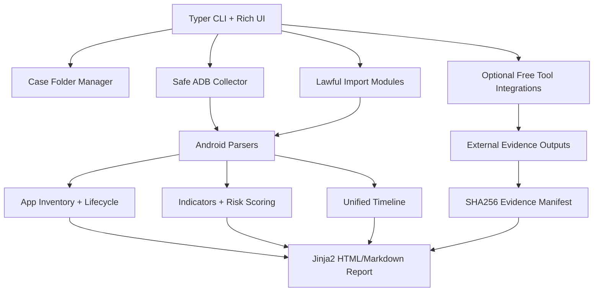

# DroidForensicX

**DroidForensicX — Free Android Defence Forensic Triage & Reporting Framework**


Created by **Faysal Ferdous**.

DroidForensicX is an open-source Android logical forensic triage framework for authorized DFIR, SOC, incident response, and defence investigation work. It turns safe ADB collection, lawful external exports, app lifecycle traces, suspicious indicators, timelines, hashes, and professional reports into one repeatable case workflow.

It is built for the first hours of an Android investigation: establish device context, preserve logical evidence, identify risky app behavior, surface uninstalled-app traces, protect sensitive values, and produce a report that an analyst can hand to a reviewer.

[View the synthetic case report](examples/demo_case_synthetic/report.md)

| Time (UTC) | App | Recorded event |
| --- | --- | --- |
| 2026-07-12 10:20 | `com.shortlived.proxy` | The app lifecycle timeline records `lastTimeUsed`. |

## Core Positioning

DroidForensicX is not a password dumper and not a bypass tool. It is an authorized Android logical forensic triage, app lifecycle, evidence hashing, timeline, risk scoring, and reporting framework.

**DroidForensicX does not extract, decrypt, dump, or bypass passwords. It only imports lawfully provided credential exports and redacts secrets by default.**

It does not root devices, bypass lockscreens, exploit Android, defeat the app sandbox, decrypt browser password stores, dump private social media databases, or claim complete deleted-file recovery from modern Android internal storage. It does not replace Cellebrite, Magnet, MSAB, Oxygen, or any commercial forensic suite.

## Why Analysts Use It

- Build a clean case folder with notes, manifest, chain-of-custody starter, raw evidence, analysis, hashes, and reports.
- Run safe, read-only ADB triage commands without clearing logs or changing phone settings.
- Continue gracefully when optional tools are missing, and document that gap in the report.
- Convert noisy Android artifacts into app inventory, lifecycle confidence, suspicious indicators, and timeline events.
- Import official credential exports without exposing raw passwords in normal outputs.
- Generate a polished HTML/Markdown report for review, escalation, or case handoff.
- Demo the full workflow without a real phone.

## Feature Matrix

| Area | Output |
| --- | --- |
| Case management | `case_manifest.json`, `case_notes.md`, `chain_of_custody.md` |
| Safe ADB collection | `getprop`, `settings`, `dumpsys`, `ps`, network state, `logcat -d` |
| App inventory | `apps_current.csv`, `apps_permissions.csv`, `apps_summary.json` |
| App lifecycle | `apps_lifecycle.csv`, `apps_uninstalled_candidates.csv`, confidence levels |
| Indicators | `suspicious_indicators.csv`, `app_risk_score.json`, `risk_summary.json` |
| Credentials | redacted CSVs, reuse groups, weak-password indicators, sensitive domains |
| Media | file index, metadata, timeline, duplicate hashes |
| Social imports | lawful export index, chat timeline, contact mentions |
| Timeline | `timeline.csv`, `timeline.md`, `timeline.html` |
| Integrity | `SHA256SUMS.txt`, `evidence_manifest.json`, `hash_verify.txt` |
| Offline file recovery | PhotoRec carving, TSK undelete candidates, authorized export import, SHA-256 manifests |
| Reporting | `report.html`, `report.md`, `executive_summary.md` |

## Architecture



## Installation

Install from the GitHub-ready ZIP:

```bash
unzip DroidForensicX-GitHub-Ready.zip
cd DroidForensicX
python3 -m venv .venv
source .venv/bin/activate
pip install -U pip wheel
pip install -e .
droidforensicx --help
```

Install from Git:

```bash
git clone https://github.com/faysalferdous/DroidForensicX.git
cd DroidForensicX
python3 -m venv .venv
source .venv/bin/activate
python -m pip install -U pip wheel
pip install -e .
droidforensicx --help
```

Manual install:

```bash
python3 -m venv .venv
. .venv/bin/activate
python -m pip install -U pip
python -m pip install -e ".[dev]"
```

## Quick Start

```bash
droidforensicx init --case BN-CASE-001 --examiner "Hashcode"
droidforensicx check-device --case BN-CASE-001
droidforensicx acquire-basic --case BN-CASE-001
droidforensicx bugreport --case BN-CASE-001
droidforensicx app-inventory --case BN-CASE-001
droidforensicx app-lifecycle --case BN-CASE-001
droidforensicx indicators --case BN-CASE-001
droidforensicx timeline --case BN-CASE-001
droidforensicx hash --case BN-CASE-001
droidforensicx report --case BN-CASE-001
```

One-command workflow:

```bash
droidforensicx defence-full --case BN-CASE-001 --examiner "Hashcode"
```

Demo workflow:

```bash
droidforensicx demo --case DEMO-ANDROID-FORENSIC
open cases/DEMO-ANDROID-FORENSIC/14_reports/report.html
```

## CLI Commands

| Command | Purpose |
| --- | --- |
| `init` | Create a forensic case folder and manifest |
| `check-device` | Check `adb`, connected devices, and authorization state |
| `acquire-basic` | Run safe ADB logical collection |
| `bugreport` | Store `adb bugreport` output |
| `androidqf` | Run AndroidQF when installed |
| `mvt` | Run supported `mvt-android` checks when inputs exist |
| `app-inventory` | Parse current apps and permissions |
| `app-lifecycle` | Detect installed and possible previously installed apps |
| `media-scan` | Index lawful shared-storage or imported media |
| `credential-import` | Import official credential CSV exports with redaction |
| `social-import` | Import lawful social/browser/chat exports |
| `indicators` | Generate suspicious indicators and risk scoring |
| `timeline` | Build a unified timeline |
| `hash` | Hash evidence and generated outputs |
| `report` | Generate professional reports |
| `defence-full` | Run the main workflow end to end |
| `recover-all` | Run all applicable methods across explicitly selected images and exports |
| `recover-verify` | Verify recovered file hashes against a run manifest |
| `recover-image` | Recover candidates from an authorized offline image |
| `recover-import` | Import an authorized local backup or media export |
| `demo` | Build a complete synthetic demo case |

## Case Folder Layout

```text
cases/<CASE_ID>/
├── 00_case/
├── 01_raw_adb/
├── 02_bugreport/
├── 03_androidqf/
├── 04_mvt/
├── 05_aleapp/
├── 06_apps/
├── 07_media/
├── 08_credentials_sensitive/
├── 09_credentials_redacted/
├── 10_social_imports/
├── 11_indicators/
├── 12_timeline/
├── 13_hashes/
├── 14_reports/
└── 15_recovery/
```

## Universal File Recovery

See [the recovery guide](docs/recovery.md) for installation, image recovery, export import and synthetic tests. Recovery is limited to readable offline images and accessible exports; permanent Android internal-storage recovery is not guaranteed.

## Credential Evidence Handling

The `credential-import` module accepts official, lawfully provided CSV exports such as Chrome/Google Password Manager/Firefox/Edge desktop exports. The original file is stored in `08_credentials_sensitive/` and hashed. Analysis outputs are written to `09_credentials_redacted/`.

Normal outputs and reports never print raw password values. Passwords are represented as `********`. The tool may compare passwords internally for reuse grouping and weak-password indicators, but the report remains redacted by default.

```bash
droidforensicx credential-import --case BN-CASE-001 --csv official_password_export.csv
```

## App Lifecycle Analysis

DroidForensicX correlates:

- current package lists
- `pm list packages -u`
- `dumpsys package`
- `dumpsys usagestats`
- package events in `logcat`
- bugreport traces
- accessible `/sdcard/Android/data` and `/sdcard/Android/media` leftovers when collected

Confidence levels:

| Level | Meaning |
| --- | --- |
| `CONFIRMED_INSTALLED` | Present in current package or `dumpsys package` evidence |
| `CONFIRMED_UNINSTALLED_TRACE` | Strong historical package trace |
| `POSSIBLE_PREVIOUSLY_INSTALLED` | Usage/logcat/bugreport trace without current install |
| `WEAK_TRACE_ONLY` | Low-context artifact trace |
| `NO_EVIDENCE` | No supporting evidence |

Android does not guarantee permanent uninstall history. Lifecycle results are evidence-ranked leads, not automatic conclusions.

## Optional Tool Integrations

DroidForensicX detects and can use these free tools when installed:

- `adb` / Android platform-tools
- AndroidQF
- MVT / `mvt-android`
- ALEAPP
- `exiftool`
- `mediainfo`
- `photorec` / `testdisk`
- `hashdeep`

Missing tools are recorded as warnings and the workflow continues with available modules.

## Report Preview

The demo report contains:

- executive summary cards
- risk level and indicator counts
- device identity table
- installed app and uninstalled trace tables
- risky permissions
- redacted credential evidence
- timeline excerpt
- hash appendix
- explicit legal and technical limitations

Generate it locally:

```bash
droidforensicx demo --case DEMO-ANDROID-FORENSIC
```

Then open:

```text
cases/DEMO-ANDROID-FORENSIC/14_reports/report.html
```

## Safety Defaults

- `subprocess` calls use argument lists and `shell=False`.
- ADB collection uses read-only commands.
- Logs are collected with `logcat -d`; they are not cleared.
- Original credential exports are separated from redacted outputs.
- Secret-like keys such as `password`, `passwd`, `pwd`, `token`, `api_key`, and `secret` are redacted in normal handling.
- Tests run without a real Android device.

## Limitations

- No-root ADB cannot access most app-private databases.
- Modern Android deleted internal file recovery is limited without specialized lawful acquisition.
- Browser passwords are not extracted or decrypted.
- Social media private databases are not bypassed.
- App uninstall history may be incomplete.
- Missing optional tools reduce coverage but do not stop reporting.
- Absence of evidence is not evidence of absence.

## Roadmap

- Richer ALEAPP import support.
- More bugreport parsers.
- Static report charts.
- Additional official export formats.
- More app-risk heuristics and fixtures.
- Optional signed report bundle export.

## Contributing

Pull requests are welcome. Contributions must preserve:

- authorized-use boundaries
- default secret redaction
- no bypass, exploit, credential dumping, or sandbox violation logic
- safe subprocess usage
- tests that run without a real Android device
- professional report language

## License

MIT License. See [LICENSE](LICENSE).
